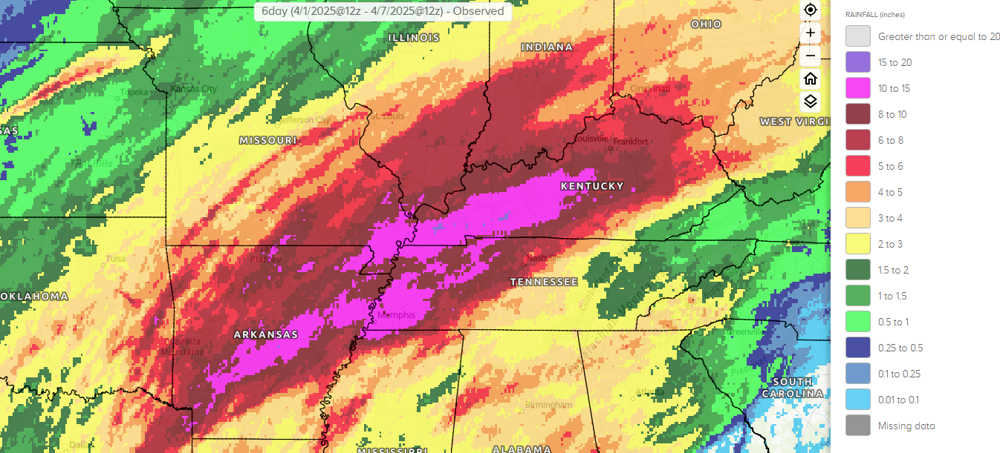
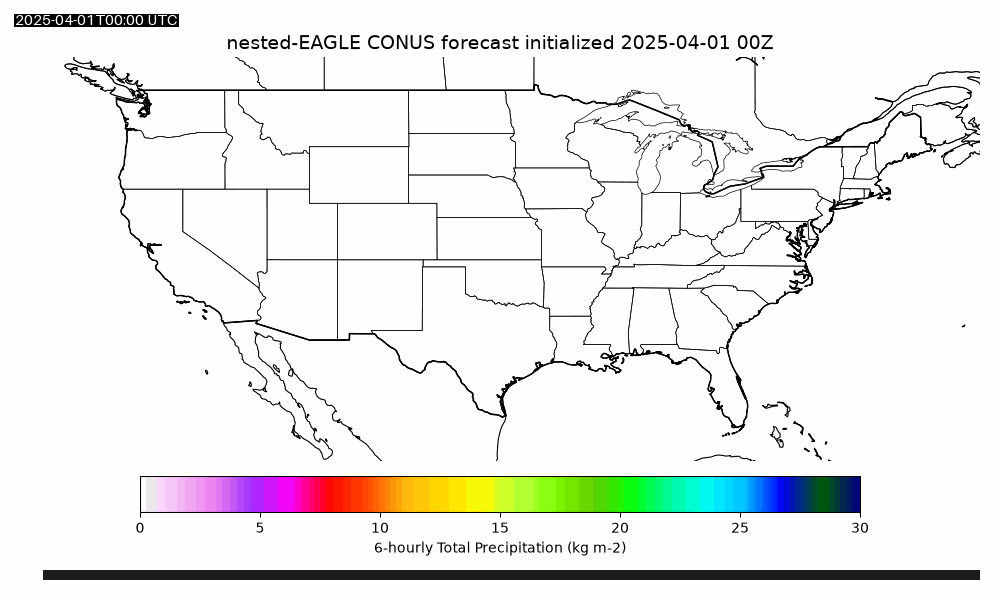
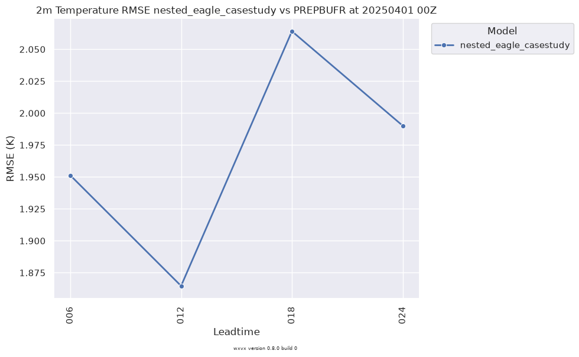
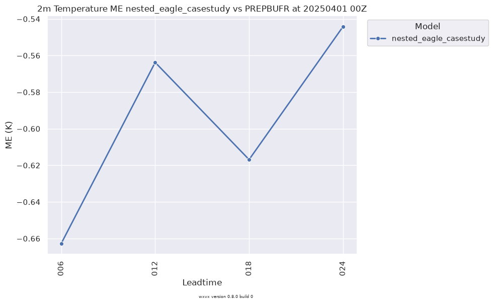
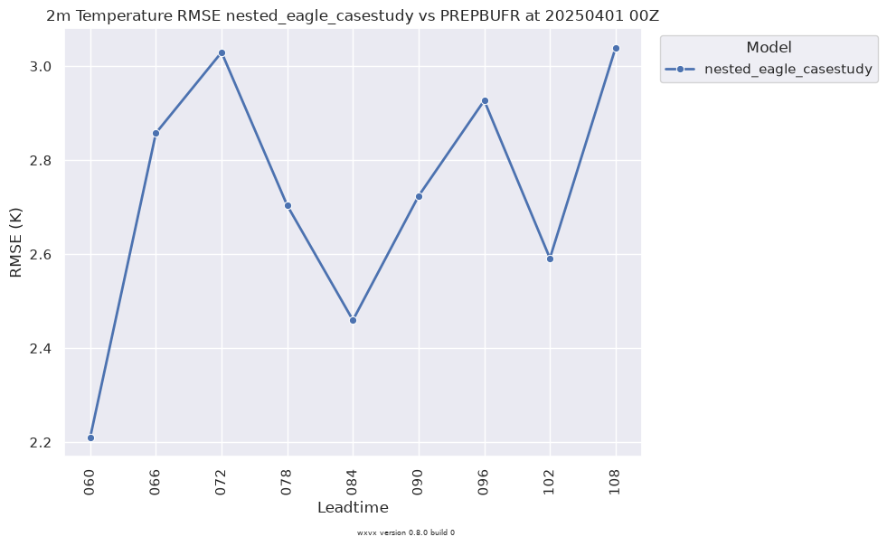
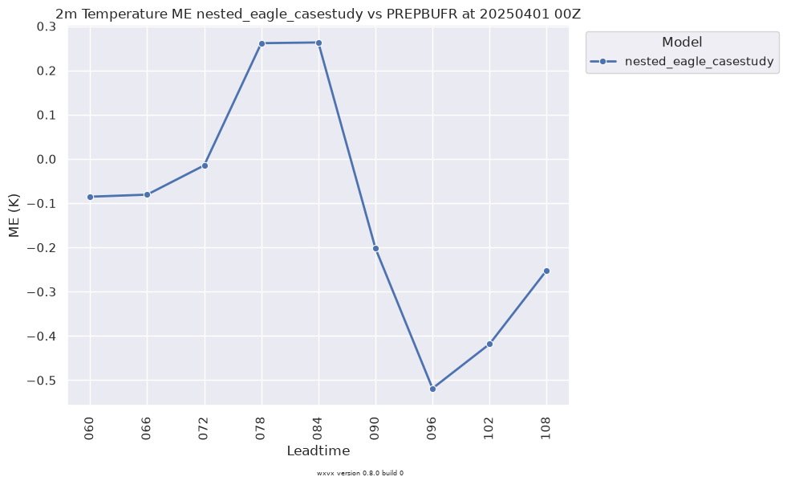

NOAA Nested-EAGLE (CONUS) Forecast Verification Using NOAA-GSL wxvx Package: A Case Study
========

This case study is designed to guide users through the entire pathway from forecast creation to validation of a NOAA Nested-EAGLE forecast
using the NOAA GSL wxvx verification package. 

The forecast is created using the notebook `here <https://planetarycomputer.microsoft.com/dataset/nested-eagle-conus#Example-Notebook>`_,
which is also located (nested_eagle_case_study.ipynb) in the case study files in this repository, ready for local download. 

Step 1: Introduction and Requirements
###################

This case study uses the example of the April 1-6, 2025 severe weather outbreak which spanned parts of the lower Mississippi
Valley, mid-South, and lower Ohio Valley. Widespread flooding across multiple states and historic river levels occurred.
Over 15 inches of rain were observed in some areas, as an Atlantic high-pressure system stalled over the region. 
Approximately `$4.1 billion in damages <https://www.ajg.com/gallagherre/-/media/files/gallagher/gallagherre/news-and-insights/2025/october/natural-catastrophe-and-climate-report-q3-2025.pdf>`_ 
were reported in addition to greater economic losses (supply-chain disruptions, uninsured damages, etc.), and 
`24 people died <https://abcnews.com/US/deadly-flooding-south-severe/story?id=120636843>`_. 

Forecasting these types of costly and deadly events is critical, but can be difficult. Through this case study, we will examine 
the forecast skill of the Nested-Experimental Artificial Intelligence Global and Limited-area Ensemble (Nested-EAGLE)
experimental machine-learning weather forecast system in predicting this event. 

Image: `National Weather Service <https://www.weather.gov/crh/2025April1-6>`_

First, an environment to run the Nested-EAGLE forecast notebook (nested_eagle_case_study.ipynb) can be set up using the requirements.txt file.

Additionally, the wxvx package will need to be installed. Please follow the instructions `here <https://github.com/NOAA-GSL/wxvx/blob/main/README.md#example>`_
to do so. 

This case study also provides instructions on creating and verifying, using the same method, a HRRR forecast to compare to the 
verification of the Nested-EAGLE forecast. To do this, the ufs2arco package is used to create a forecast using the hrrr.yaml file. The
instructions for ufs2arco can be found `here <https://ufs2arco.readthedocs.io/en/latest/>`_.

Step 2: Running Nested-EAGLE Notebook and Creating the Forecast
###################

Run the notebook (nested_eagle_case_study.ipynb) per instructions in the file, or following instructions at the link above. 

The notebook begins by identifying the forecast initialization start and end dates and time (Zulu). 
A forecast horizon of 10 days (240 hours) at 6-hour intervals can be run for desired variables such as temperature, winds, 
precipitation, etc. 

In the notebook, step 7 saves and formats the output zarr file for verification in wxvx. 

Then, several visualizations can be created to better understand and visualize the magnitude of the event. 

For example, the following visualization depicts 6-hour accumulated precipitation at each step in the 10-day initialized 
nested-EAGLE forecast for the April 2025 severe precipitation event examined in this case study:

A strengthening Atlantic high-pressure system stalled the storm over the Midwest and South for several days, beginning in the afternoon of April 2
and continuing thorugh the evening of April 6. There were multiple waves of the storm, first beginning on April 2 with a severe thunderstorm and tornado 
outbreak. Continued thrunderstorms over the next several days brought more rain, with the heaviest rainfall on the evening of April 4 through the evening 
of April 5. In many areas, 6-12 inches of rain were observed, with up to 16 inches in some area. 

This observed storm is generally depicted in the above graphic, but we will quantify the skill of this particular forecast for this event using wxvx. 

Step 3: Verifying Nested-EAGLE Forecast Using wxvx 
###################

The documentation for wxvx can be found `here <https://github.com/NOAA-GSL/wxvx/blob/main/README.md#example>`_ with a full explanation of the process to
download and run the package locally. 

There are two example .yaml files in this repository for two separate verifications: one is an example temperature 
verification and the other is a precipitation verification, which will be more thoroughly discussed 
for this case study. 

To verify temperature for the forecast, use wxvx_temperature.yaml as a template. Set: 

cycles:
  start: 2025-04-01T00:00:00
  step: 0
  stop: 2025-04-01T00:00:00  

These times indicate the initialization date and time of the forecast created from nested-EAGLE. In this case, 2025-04-01 at 00Z. To verify separate times 
across the 240-hr forecast, define desired leadtimes:

leadtimes:
  start: '0'
  step: '6:00:00'
  stop: '24'

We begin with the first 24 hours of the forecast in increments of 6 hours. Temperature is verified using the PREPBUFR 
observational data. More information can be found in the wxvx documentation. The verification is run using: 

wxvx -n 1 -c /wxvx_temperature.yaml -t plots

Two plots for temperature verification are produced: Root Mean Square Error (RMSE) and Mean Error (ME) in Kelvin.

   The RMSE of 2m temperature for the first 24 hours of the forecast shows forecast error generally increase 
   as forecast time increases.

   The ML forecast has a strong, consistent cold bias during the first 24 hours, averaging approximately −0.60 K. 

Similarly, to verify precipitation for the forecast, use wxvx_precipitation.yaml as a template. The precipitation data
is verified using the NCEP/CPC Four Kilometer Precipitation, dataset d507005 ("STAGEIV"). Data in the archive for 
April 2025 can be found `here <https://data.gdex.ucar.edu/d507005/stage4/stage4.202504.tartar>`_.

The cycles and leadtimes definitions remain the same as before. Five verification plots are produced: 
Critical Success Index (CSI), Heidke Skill Score (HSS), and Fraction Skill Score (FSS) at three widths: 
3, 5, and 11. 

CSI is a measure used to evaluate forecast precipitation occurrence, in other words: 

CSI = Hits / (Hits + Misses + False Alarms)

On a scale from 0 to 1, a higher CSI indicates higher skill. 

HSS measures forecast skill against random chance, where a score of 1 indicates perfect, 0 indicates 
the forecast is random, and negative values indicate worse than random forecasting. 

FSS ranges from 0 to 1, with a higher score indicating greater forecast skill at determining if the forecast 
predicting the correct amount of precipitation in the correct location. The FSS is evaluated at three widths, 
with width 3 evaluating fine-scale precipitation placement, width 3 evaluating mesoscale placement, and 
width 11 evaluating the large-scale precipitation placement. 

For all of these metrics, forecast skill is evaluated at four thresholds: 1, 5, 10, 
and 25, each representing precipitation in kg m^-3, or mm. The results of the forecast verification using 
wxvx for precipitation in the first 24 hours of this event are shown below:

.. image:: tp-surface-CSI-plot_begin.png

.. image:: tp-surface-FSS-width-3-plot_begin.png

.. image:: tp-surface-FSS-width-5-plot_begin.png

.. image:: tp-surface-FSS-width-11-plot_begin.png

.. image:: tp-surface-HSS-plot_begin.png
    For this event, the Nested-Eagle forecast demonstrated consistently strong skill for light precipitation 
    (≥1 mm) throughout the first 24 hours and maintained useful skill for moderate (≥5 mm) and heavy (≥10 mm) 
    precipitation even as lead time increased. High FSS values across all neighborhood sizes indicate that the 
    model generally captured the placement and spatial structure of precipitation systems well, with only a 
    temporary reduction in skill around hour 12 before recovering by hours 18-24.

Next, we will verify a different time period in the forecast using the same wxvx_temperature.yaml and 
wxvx_precipitation.yaml files. The cycles definition remains the same as before, however, we will now verify a 
different point in the event where precipitation intensity is much greater.  

leadtimes:
  start: '60'
  step: '6:00:00'
  stop: '108'

Here, the forecast is verified beginning at hour 60 (2025-04-03 at 12Z) through hour 108 (2025-04-05 at 12Z), the 
concentration of heaviest precipitation during this event, though any start and stop time can be specified as 
number of hours (in increments of 6 hours) from forecast initialization. The following is the resulting RMSE in 
Kelvin of the temperature for this forecast from hours 60 through 108. 

   The RMSE varies with time throughout hours 60 through 108. 

    During hours 60–108, the average bias improves substantially to about −0.12 K, but the lead-by-lead behavior 
    becomes less stable, alternating between warm and cold biases.

For precipitation: 

.. image:: tp-surface-CSI-plot.png

.. image:: tp-surface-FSS-width-3-plot.png

.. image:: tp-surface-FSS-width-5-plot.png

.. image:: tp-surface-FSS-width-11-plot.png

.. image:: tp-surface-HSS-plot.png
    For forecast hours 60–108, precipitation skill remains useful but becomes more variable by lead time and 
    threshold. The model appears better at forecasting the precipitation system and its approximate regional 
    footprint than the exact location of threshold exceedances. That conclusion is especially strong later in the 
    forecast, when width-11 FSS frequently exceeds 0.9 even where CSI is only 0.2–0.4.

Compared with the first 24 hours, later forecasts have slightly reduced light-precipitation categorical skill but 
surprisingly stronger heavy- and extreme-event performance at selected times. The high large-neighborhood FSS 
indicates that later errors are frequently correctable spatial or timing errors, rather than complete misses of the 
precipitation intensity.

Step 3: Verifying a HRRR Forecast with wxvx to Compare to Nested-EAGLE Verification 
###################

Given these findings, it is also important to verify the `High Resolution Rapid Refresh (HRRR) <https://rapidrefresh.noaa.gov/hrrr/>`_
for this same forecast time. We want to compare how the Nested-EAGLE forecast performed against the HRRR, 
with the goal of at least being as skillful or better than the HRRR. We will have two HRRR forecast initializations,
because the HRRR only produces 48-hr forecasts. 

We begin again with the first 24 hours of this event (using the hrrr.yaml and running with ufs2arco): 
    t0:
      start: 2025-04-01T00
      end: 2025-04-01T00
      freq: 6h
    fhr:
      start: 6
      end: 24
      step: 6

Due to the nature of the HRRR forecast preparation, some post-processing is required to obtain 6-hourly accumulated
precipitation, similar to the structure of the Nested-EAGLE forecast for direct comparison. This step is explained
in the second half of the nested_eagle_case_study.ipynb. This notebook then adjusts the dimensions of the variables 
and data structure for formatting into the wxvx format requirements. Finally, this notebook produces the 
following visualization of the forecast:

.. image:: hrrr_6hr_precip_forecast_begin.gif
   For the first 24 hours of the event 

.. image:: hrrr_6hr_precip_forecast_middle.gif
   For forecast hours 60-108 of the event. Please note that this figure shows hours 6-48, as The
   HRRR forecast must be initialized again beginning 4-3-26 at 12Z given that HRRR is only able to produce 
   48-hr forecasts, and not the full 240-hr forecast like Nested-EAGLE. For the HRRR images in this section, 
   hours 6-48 are equivalent in time to hours 60-108 of the Nested-EAGLE forecast (4-3-26 at 12Z through 4-5-26 at 12Z).

The forecast is verified similarly to Nested-EAGLE, using wxvx and the following yaml: wxvx_temperature_hrrr.yaml 
We obtain the following results for temperature for the first 24 hours of the event: 

.. image:: 2t-heightAboveGround-0002-RMSE-plot_hrrr_begin.png
   Error increases as forecast time increases in the first 24 hours. 

.. image:: 2t-heightAboveGround-0002-ME-plot_hrrr_begin.png
   The forecast shows increasingly negative cold bias with time. 

The precipitation forecast is verified similarly to Nested_EAGLE, using wxvx and the following yaml: wxvx_precipitation_hrrr.yaml 
We obtain the following results:

.. image:: tp-surface-CSI-plot_hrrr.png

.. image:: tp-surface-FSS-width-3-plot_hrrr.png

.. image:: tp-surface-FSS-width-5-plot_hrrr.png

.. image:: tp-surface-FSS-width-11-plot_hrrr.png

.. image:: tp-surface-HSS-plot_hrrr.png
   HRRR showed strong skill for light precipitation and reasonable skill for moderate to heavy precipitation 
   at the shortest lead time (6 h), but skill degraded rapidly after initialization, particularly for the ≥10 mm 
   and ≥25 mm thresholds. While neighborhood-based FSS indicated HRRR often captured the general precipitation 
   region,categorical skill metrics (CSI and HSS) suggest it struggled to accurately forecast the intensity and 
   placement of heavier rainfall beyond the first few forecast hours.

Next, we examine the forecast for the part of this event with the heaviest precipitation, hours 60-108 from
4-1-26 at 0Z, or hours 6-48 for the HRRR forecast initialized at 4-3-26 at 12Z (hrrr.yaml.):

    t0:
      start: 2025-04-03T12
      end: 2025-04-03T12
      freq: 6h
    fhr:
      start: 6
      end: 48
      step: 6

Results of the temperature verification are as follows:

.. image:: 2t-heightAboveGround-0002-RMSE-plot_hrrr_middle.png
   The RMSE varies with time through 4-3-26 at 12Z to 4-5-25 at 12Z. 

.. image:: 2t-heightAboveGround-0002-ME-plot_hrrr_middle.png
   A cold bias is present throughout the forecast, with hours 30-36 having the greatest error. 

Then, we run the wxvx verification for precipitation for this forecast and obtain the following results:

.. image:: tp-surface-CSI-plot_hrrr_middle.png

.. image:: tp-surface-FSS-width-3-plot_hrrr_middle.png

.. image:: tp-surface-FSS-width-5-plot_hrrr_middle.png

.. image:: tp-surface-FSS-width-11-plot_hrrr_middle.png

.. image:: tp-surface-HSS-plot_hrrr_middle.png
   For this later period of the event, HRRR exhibits substantially better and more sustained precipitation skill 
   than it showed during the first 24-hour evaluation window. Skill remains relatively high across all thresholds 
   through 48 hours, with particularly strong performance for light (≥1 mm) and moderate (≥5 mm) precipitation 
   and some useful skill for heavy (≥10 mm) and extreme (≥25 mm) precipitation thresholds compared to the first 24 
   hours of the event.

Compared to HRRR, the Nested-Eagle forecast generally maintained higher CSI, HSS, and FSS values from hours 12-24, 
especially for the operationally important ≥5 mm and ≥10 mm precipitation thresholds. This suggests Nested-Eagle 
was better able to preserve the location and intensity structure of precipitation features as lead time increased, 
whereas HRRR experienced a more rapid loss of skill. Broadly, the results indicate that Nested-Eagle adds value 
beyond HRRR for this case by providing more consistent precipitation forecasts through the first 24 hours, although 
both systems continued to struggle with the most extreme precipitation amounts (≥25 mm).

Nested-EAGLE Forecast Notebook Citation: The Earth Prediction Innovation Center (EPIC) and the NOAA AI for Numerical Weather Prediction (AI4NWP) 
Working Group. (2026). The nested-EAGLE (Experimental AI Global and Limited-area Ensemble forecast system) v1.1.0. 
`Zenodo <https://doi.org/10.5281/zenodo.19672026>`_.